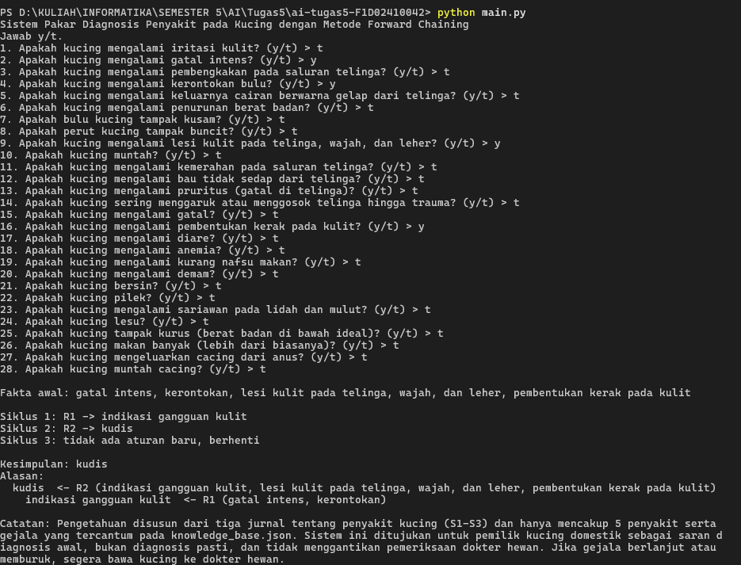
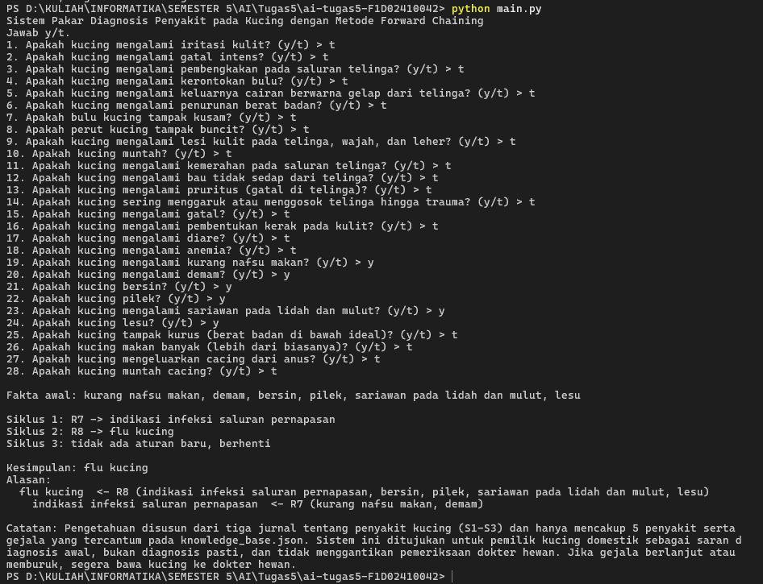
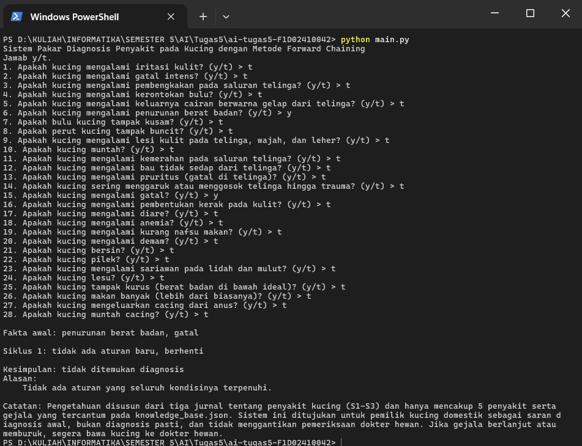

# Sistem Pakar Diagnosis Penyakit pada Kucing dengan Metode Forward Chaining

Tugas 5 - Kecerdasan Buatan (MKL1303131), Teknik Informatika UNRAM.

| Identitas | Keterangan |
| --- | --- |
| Nama | **[Nama Mahasiswa]** |
| NIM | **F1D02410042** |
| Mata kuliah | Kecerdasan Buatan (MKL1303131) |
| Program studi | Teknik Informatika, Universitas Mataram |

> Ganti **[Nama Mahasiswa]** dengan nama lengkap sebelum repository dikumpulkan.

## 1. Topik dan tujuan

Topik tugas ini adalah **diagnosis awal penyakit pada kucing domestik**. Program menerima jawaban gejala dari pengguna, menjalankan aturan IF-THEN dengan metode **Forward Chaining**, lalu menampilkan:

1. kesimpulan penyakit yang mungkin,
2. jejak siklus inferensi,
3. alasan aturan yang dipakai,
4. batas keberlakuan sistem.

Sistem ini hanya memberi **saran diagnosis awal**. Sistem tidak menggantikan pemeriksaan, diagnosis, dan penanganan dokter hewan.

## 2. Sumber referensi

Ketiga sumber di bawah adalah artikel jurnal. Sitasi mengikuti halaman pertama PDF yang dilampirkan. Tanggal akses: 14 November 2026.
 |
| S1 | Wildan Mukholad Fauzi, Garno, Iqbal Maulana. *Sistem Pakar Diagnosis Penyakit pada Kucing Menggunakan Metode Forward Chaining dan Algoritma Naive Bayes*. JATI (Jurnal Mahasiswa Teknik Informatika), Vol. 9 No. 3, Juni 2025, hlm. 4672-4679. https://doi.org/10.36040/jati.v9i3.13823 | Sumber utama aturan R1-R10, daftar penyakit, gejala, dan konsep Forward Chaining. |
| S2 | Riswan Fauzan, N. Nelis Febriani SM, Robby Maududy. *Sistem Pakar Diagnosa Penyakit Pada Kucing Domestik Menggunakan Metode Certainty Factor Dan Forward Chaining Berbasis Android*. Informatics and Digital Expert (INDEX), Vol. 7 No. 2, 2025, hlm. 168-176. https://doi.org/10.36423/index.v7i2.2427 | Sumber aturan alternatif R11 (cacingan) dan pembanding gejala penyakit kucing. |
| S3 | Jimsan Jimsan, Satriani Satriani. *Sistem Pakar untuk Identifikasi Penyakit pada Kucing dengan Pendekatan Forward Chaining dan Certainty Factor*. EXPLORE: Jurnal Sistem Informasi dan Telematika, Vol. 17 No. 1, Juni 2026, hlm. 16-24. https://doi.org/10.36448/jsit.v17i1.4521 | Pembanding konsep Forward Chaining dan daftar penyakit. |

### Perbedaan antar sumber dan pilihan yang dipakai

Sumber-sumber tidak selalu memakai nama penyakit, kode gejala, atau aturan yang sama. Perbedaannya saya rangkum seperti ini.

1. **Jumlah data.** S1 memakai 12 penyakit dan 32 gejala (penyakit P01-P12, gejala G01-G32); S2 memakai 10 penyakit dan 31 gejala (P01-P10, G01-G31); S3 memakai 11 penyakit dan 37 gejala (P001-P011, G01-G37). Kode gejala juga bertabrakan, misalnya G25 di S1 adalah sariawan, sedangkan G25 di S2 adalah keluar cacing dari anus.
2. **Flu Kucing.** S1 menghubungkan Flu Kucing dengan *Herpesvirus* (P07). S2 memakai nama *Feline Calicivirus (Flu Kucing)* dan memisahkan *Feline Rhinotracheitis (Herpes Virus)*. S3 mendefinisikan Flu Kucing dengan lemah, lesu, leleran hidung, dan bersin. Knowledge base ini mengikuti aturan P07 dari S1 karena S1 adalah sumber utama dan aturannya jelas. Aturan S2/S3 tidak digabung ke aturan flu agar definisi virusnya tidak tercampur.
3. **Kudis, Pijal, dan Ektoparasit.** S1 memisahkan Kudis (Skabies) dan Pijal (Ektoparasit). S2 memakai *Scabies (Ektoparasit)* dengan gejala penebalan kulit, sedangkan S3 memakai *Scabies* dengan gejala gatal ekstrem, iritasi, kopeng telinga, dan kutuan. Knowledge base ini mengikuti S1 untuk Kudis (R1-R2) dan Pijal (R3-R4).
4. **Cacingan.** S1 memakai penurunan berat badan, bulu kusam, perut buncit, muntah, dan diare (P01). S2 memakai kurus, makan banyak, keluar cacing dari anus, dan muntah cacing (P08). S3 memakai lemah, diare, muntah, nafsu makan turun, perut buncit, dan bulu kusam (P006). Aturan S1 saya pakai di R5-R6; aturan S2 saya pakai sebagai **aturan alternatif** di R11. Keduanya tidak digabung karena gejalanya berbeda.
5. **S3 sebagai pembanding.** Definisi penyakit dan kode gejala S3 paling berbeda dari S1/S2. Karena itu S3 tidak dipakai sebagai sumber aturan, tetapi dipakai untuk membandingkan konsep Forward Chaining dan memastikan daftar penyakit wajar.

Kode S2-G23 sampai S2-G26 di JSON diberi awalan `S2-` supaya tidak tertukar dengan kode G23-G26 milik S1.

## 3. Knowledge base

File aturan: `knowledge_base.json`. Program membaca file ini; aturan tidak ditulis di dalam `main.py`.

Isi knowledge base:

- **5 penyakit:** cacingan, kudis, pijal, infeksi telinga, flu kucing.
- **28 gejala** yang ditanyakan ke pengguna.
- **11 aturan:** R1-R10 dari S1 dan R11 dari S2.
- **5 fakta antara:** `indikasi gangguan kulit`, `indikasi ektoparasit`, `indikasi gangguan pencernaan`, `indikasi infeksi saluran pernapasan`, `indikasi infeksi telinga`.

Fakta antara adalah hanya **istilah buatan untuk tugas ini**, bukan nama diagnosis resmi dari jurnal. Fungsinya hanya untuk membuat aturan berantai: hasil aturan pertama dipakai oleh aturan berikutnya.

### 3.1 Daftar penyakit

| Penyakit | Nama lengkap di sumber | Kode S1 | Aturan |
| --- | --- | --- | --- |
| cacingan | Cacingan (Helminthiasis) | P01 | R5-R6 dan R11 (S2) |
| kudis | Kudis (Skabies) | P02 | R1-R2 |
| pijal | Pijal (Ektoparasit) | P03 | R3-R4 |
| infeksi telinga | Infeksi Telinga (Otodectes Cynotis) | P04 | R9-R10 |
| flu kucing | Flu Kucing (Herpesvirus) | P07 | R7-R8 |

### 3.2 Daftar gejala

| Kode | Gejala | Sumber |
| --- | --- | --- |
| G01 | iritasi kulit | S1 |
| G02 | gatal intens | S1 |
| G03 | pembengkakan pada saluran telinga | S1 |
| G04 | kerontokan | S1 |
| G05 | keluarnya cairan berwarna gelap dari telinga | S1 |
| G06 | penurunan berat badan | S1 |
| G07 | bulu yang kusam | S1 |
| G08 | perut buncit | S1 |
| G09 | lesi kulit pada telinga, wajah, dan leher | S1 |
| G10 | muntah | S1 |
| G11 | kemerahan pada saluran telinga | S1 |
| G12 | bau tidak sedap dari telinga | S1 |
| G13 | pruritus (gatal di telinga) | S1 |
| G14 | menggaruk atau menggosok telinga (trauma) | S1 |
| G15 | gatal | S1 |
| G16 | pembentukan kerak pada kulit | S1 |
| G17 | diare | S1 |
| G18 | anemia | S1 |
| G21 | kurang nafsu makan | S1 |
| G22 | demam | S1 |
| G23 | bersin | S1 |
| G24 | pilek | S1 |
| G25 | sariawan pada lidah dan mulut | S1 |
| G26 | lesu | S1 |
| S2-G23 | kurus (kurang dari berat ideal biasanya) | S2 |
| S2-G24 | makan banyak | S2 |
| S2-G25 | keluar cacing dari anus | S2 |
| S2-G26 | muntah cacing | S2 |

Kode S1 G19, G20, dan G27-G32 tidak muncul karena tidak dipakai oleh 5 penyakit yang dipilih.

### 3.3 Tabel aturan IF-THEN

| Aturan | IF | THEN | Sumber | Jenis |
| --- | --- | --- | --- | --- |
| R1 | gatal intens AND kerontokan | indikasi gangguan kulit | S1 | fakta antara |
| R2 | indikasi gangguan kulit AND lesi kulit pada telinga, wajah, dan leher AND pembentukan kerak pada kulit | kudis | S1 | diagnosis |
| R3 | iritasi kulit AND kerontokan | indikasi ektoparasit | S1 | fakta antara |
| R4 | indikasi ektoparasit AND gatal AND anemia | pijal | S1 | diagnosis |
| R5 | penurunan berat badan AND muntah | indikasi gangguan pencernaan | S1 | fakta antara |
| R6 | indikasi gangguan pencernaan AND bulu yang kusam AND perut buncit AND diare | cacingan | S1 | diagnosis |
| R7 | kurang nafsu makan AND demam | indikasi infeksi saluran pernapasan | S1 | fakta antara |
| R8 | indikasi infeksi saluran pernapasan AND bersin AND pilek AND sariawan pada lidah dan mulut AND lesu | flu kucing | S1 | diagnosis |
| R9 | menggaruk atau menggosok telinga (trauma) AND bau tidak sedap dari telinga | indikasi infeksi telinga | S1 | fakta antara |
| R10 | indikasi infeksi telinga AND pembengkakan pada saluran telinga AND keluarnya cairan berwarna gelap dari telinga AND kemerahan pada saluran telinga AND pruritus (gatal di telinga) | infeksi telinga | S1 | diagnosis |
| R11 | kurus (kurang dari berat ideal biasanya) AND makan banyak AND keluar cacing dari anus AND muntah cacing | cacingan | S2 | diagnosis |

Aturan R2 sama dengan aturan P02 S1 (G02, G04, G09, G16) setelah dipecah menjadi R1 dan R2. Pola yang sama dipakai untuk R4, R6, R8, dan R10. Dengan cara ini, setiap penyakit tetap memakai gejala yang tercantum di jurnal, tetapi program punya rantai inferensi yang bisa ditampilkan.

## 4. Metode Forward Chaining

### 4.1 Alasan memilih Forward Chaining

Forward Chaining dipilih karena pengguna memulai konsultasi dengan **fakta gejala**, lalu sistem mencari aturan yang cocok dan bergerak maju menuju kesimpulan. Metode ini juga dipakai sebagai mesin inferensi pada ketiga jurnal sumber.

Jurnal S1 sebenarnya memakai Forward Chaining dan Naive Bayes; S2 dan S3 memakai Forward Chaining dan Certainty Factor. Pada tugas ini saya hanya memakai Forward Chaining murni. Bobot keyakinan, probabilitas, dan persentase tidak dihitung karena tugas meminta mesin inferensi sederhana yang bisa menjelaskan aturan dan alasannya. Kalau nanti ingin menampilkan persentase keyakinan, bagian itu bisa ditambahkan sebagai pengembangan terpisah.

Kekurangan Forward Chaining yang saya rasakan juga sesuai catatan S1: program menanyakan semua gejala yang ada di knowledge base, termasuk gejala yang akhirnya tidak relevan. Ini sengaja dipilih agar alur program mudah diperiksa dan sesuai contoh tugas.

### 4.2 Algoritma yang dipakai

```text
memori <- fakta yang dijawab "ya" oleh pengguna
ULANGI:
    cocok <- aturan yang syaratnya terpenuhi DAN hasilnya belum ada di memori
    JIKA cocok kosong:
        BERHENTI
    r <- cocok[0]
    tambahkan r.maka ke memori
    catat r sebagai alasan untuk r.maka
```

Program memeriksa aturan sesuai urutan di file JSON. Satu aturan dijalankan per siklus. Aturan yang hasilnya sudah ada di memori tidak dijalankan lagi supaya program berhenti.

### 4.3 Contoh rule berantai

```text
R1: IF gatal intens AND kerontokan
    THEN indikasi gangguan kulit

R2: IF indikasi gangguan kulit
    AND lesi kulit pada telinga, wajah, dan leher
    AND pembentukan kerak pada kulit
    THEN kudis
```

Jalur inferensinya:

```text
Siklus 1: R1 -> indikasi gangguan kulit
Siklus 2: R2 -> kudis
Siklus 3: tidak ada aturan baru, berhenti
```

`indikasi gangguan kulit` adalah fakta antara. Fakta ini bukan diagnosis resmi; ia hanya dipakai agar R2 bisa memakai hasil R1.

Rantai lain yang serupa:

- R3 -> `indikasi ektoparasit` -> R4 -> `pijal`
- R5 -> `indikasi gangguan pencernaan` -> R6 -> `cacingan`
- R7 -> `indikasi infeksi saluran pernapasan` -> R8 -> `flu kucing`
- R9 -> `indikasi infeksi telinga` -> R10 -> `infeksi telinga`

## 5. Cara menjalankan

Persyaratan: Python 3.8 atau lebih baru. Program utama tidak memerlukan library eksternal.

```bash
cd ai-tugas5-F1D02410042
python main.py
```

Di Windows, kalau perintah `python` tidak tersedia, gunakan:

```bash
py main.py
```

Jawab setiap pertanyaan dengan `y` (ya) atau `t` (tidak), lalu tekan Enter. Setelah semua pertanyaan dijawab, program menampilkan fakta awal, siklus inferensi, kesimpulan, alasan, dan catatan.

Untuk menjalankan pengujian otomatis:

```bash
python pengujian.py
```

`pengujian.py` menjalankan delapan kasus dan memeriksa kesimpulan, bagian `Alasan:`, dan bagian `Catatan:`.

## 6. Contoh output

Contoh Kasus 1 (Kudis). Jawaban yang diketik pengguna ditampilkan setelah tanda `>`.

```text
Sistem Pakar Diagnosis Penyakit pada Kucing dengan Metode Forward Chaining
Jawab y/t.
1. Apakah kucing mengalami iritasi kulit? (y/t) > t
2. Apakah kucing mengalami gatal intens? (y/t) > y
3. Apakah kucing mengalami pembengkakan pada saluran telinga? (y/t) > t
4. Apakah kucing mengalami kerontokan bulu? (y/t) > y
5. Apakah kucing mengalami keluarnya cairan berwarna gelap dari telinga? (y/t) > t
6. Apakah kucing mengalami penurunan berat badan? (y/t) > t
7. Apakah bulu kucing tampak kusam? (y/t) > t
8. Apakah perut kucing tampak buncit? (y/t) > t
9. Apakah kucing mengalami lesi kulit pada telinga, wajah, dan leher? (y/t) > y
10. Apakah kucing muntah? (y/t) > t
11. Apakah kucing mengalami kemerahan pada saluran telinga? (y/t) > t
12. Apakah kucing mengalami bau tidak sedap dari telinga? (y/t) > t
13. Apakah kucing mengalami pruritus (gatal di telinga)? (y/t) > t
14. Apakah kucing sering menggaruk atau menggosok telinga hingga trauma? (y/t) > t
15. Apakah kucing mengalami gatal? (y/t) > t
16. Apakah kucing mengalami pembentukan kerak pada kulit? (y/t) > y
17. Apakah kucing mengalami diare? (y/t) > t
18. Apakah kucing mengalami anemia? (y/t) > t
19. Apakah kucing mengalami kurang nafsu makan? (y/t) > t
20. Apakah kucing mengalami demam? (y/t) > t
21. Apakah kucing bersin? (y/t) > t
22. Apakah kucing pilek? (y/t) > t
23. Apakah kucing mengalami sariawan pada lidah dan mulut? (y/t) > t
24. Apakah kucing lesu? (y/t) > t
25. Apakah kucing tampak kurus (berat badan di bawah ideal)? (y/t) > t
26. Apakah kucing makan banyak (lebih dari biasanya)? (y/t) > t
27. Apakah kucing mengeluarkan cacing dari anus? (y/t) > t
28. Apakah kucing muntah cacing? (y/t) > t

Fakta awal: gatal intens, kerontokan, lesi kulit pada telinga, wajah, dan leher, pembentukan kerak pada kulit

Siklus 1: R1 -> indikasi gangguan kulit
Siklus 2: R2 -> kudis
Siklus 3: tidak ada aturan baru, berhenti

Kesimpulan: kudis
Alasan:
  kudis  <- R2 (indikasi gangguan kulit, lesi kulit pada telinga, wajah, dan leher, pembentukan kerak pada kulit)
    indikasi gangguan kulit  <- R1 (gatal intens, kerontokan)

Catatan: Pengetahuan disusun dari tiga jurnal tentang penyakit kucing (S1-S3) dan hanya mencakup 5 penyakit serta gejala yang tercantum pada knowledge_base.json. Sistem ini ditujukan untuk pemilik kucing domestik sebagai saran diagnosis awal, bukan diagnosis pasti, dan tidak menggantikan pemeriksaan dokter hewan. Jika gejala berlanjut atau memburuk, segera bawa kucing ke dokter hewan.
```

## 7. Kasus uji dan hasil

### 7.1 Tiga kasus utama

| Kasus | Jawaban "ya" | Kesimpulan yang diharapkan | Hasil program | Screenshot |
| --- | --- | --- | --- | --- |
| 1 | gatal intens, kerontokan, lesi kulit pada telinga/wajah/leher, pembentukan kerak pada kulit | kudis | kudis | [kasus 1](screenshot/kasus1_kudis.png) |
| 2 | kurang nafsu makan, demam, bersin, pilek, sariawan pada lidah dan mulut, lesu | flu kucing | flu kucing | [kasus 2](screenshot/kasus2_flu_kucing.png) |
| 3 | gatal saja | tidak ditemukan diagnosis | tidak ditemukan diagnosis | [kasus 3](screenshot/kasus3_tidak_terdiagnosis.png) |

Kasus 3 adalah kasus negatif. Hanya gejala `gatal` yang dipilih, sehingga tidak ada aturan yang seluruh kondisinya terpenuhi. Program menampilkan:

```text
Siklus 1: tidak ada aturan baru, berhenti

Kesimpulan: tidak ditemukan diagnosis
Alasan:
    Tidak ada aturan yang seluruh kondisinya terpenuhi.
```

### 7.2 Pengujian tambahan

| Kasus | Jawaban "ya" | Kesimpulan yang diharapkan | Hasil program |
| --- | --- | --- | --- |
| 4 | penurunan berat badan, bulu yang kusam, perut buncit, muntah, diare | cacingan (R5-R6, S1) | cacingan |
| 5 | iritasi kulit, kerontokan, gatal, anemia | pijal (R3-R4, S1) | pijal |
| 6 | pembengkakan saluran telinga, cairan gelap dari telinga, kemerahan saluran telinga, bau tidak sedap, pruritus, menggaruk/menggosok telinga | infeksi telinga (R9-R10, S1) | infeksi telinga |
| 7 | kurus, makan banyak, keluar cacing dari anus, muntah cacing | cacingan (R11, S2) | cacingan |
| 8 | iritasi kulit, gatal intens, kerontokan, lesi kulit, gatal, kerak kulit, anemia | kudis dan pijal (dua kesimpulan) | kudis, pijal |

Keluaran `python pengujian.py`:

```text
Pengujian sistem pakar penyakit kucing
==================================================
[LULUS] Kasus 1 - Kudis
         Harapan : kudis
         Hasil   : kudis
[LULUS] Kasus 2 - Flu Kucing
         Harapan : flu kucing
         Hasil   : flu kucing
[LULUS] Kasus 3 - Tidak Terdiagnosis
         Harapan : tidak ditemukan diagnosis
         Hasil   : tidak ditemukan diagnosis
[LULUS] Kasus 4 - Cacingan melalui S1
         Harapan : cacingan
         Hasil   : cacingan
[LULUS] Kasus 5 - Pijal
         Harapan : pijal
         Hasil   : pijal
[LULUS] Kasus 6 - Infeksi Telinga
         Harapan : infeksi telinga
         Hasil   : infeksi telinga
[LULUS] Kasus 7 - Cacingan melalui S2
         Harapan : cacingan
         Hasil   : cacingan
[LULUS] Kasus 8 - Dua Kesimpulan
         Harapan : kudis, pijal
         Hasil   : kudis, pijal
==================================================
Hasil: 8/8 kasus lulus.
```

## 8. Screenshot

Screenshot di bawah dibuat dari keluaran asli program. Jawaban yang terlihat adalah input yang diketik saat pengujian.

### Kasus 1 - Kudis



### Kasus 2 - Flu Kucing



### Kasus 3 - Tidak Terdiagnosis



## 9. Batas keberlakuan

Pengetahuan disusun dari tiga jurnal tentang penyakit kucing (S1-S3) dan hanya mencakup 5 penyakit serta gejala yang tercantum pada `knowledge_base.json`. Sistem ini ditujukan untuk pemilik kucing domestik sebagai saran diagnosis awal, bukan diagnosis pasti, dan tidak menggantikan pemeriksaan dokter hewan. Jika gejala berlanjut atau memburuk, segera bawa kucing ke dokter hewan.

## 10. Penggunaan alat bantu AI

Penggunaan AI pada Tugas 5: Opencode AI dan ChatGPT untuk solving error, membantu menyusun kalimat, dan membantu memberikan bagaimana langkah pembuatan kode yang sekiranya baru saya pelajari dan saya belum mengerti.


## 11. Referensi

1. Fauzi, W. M., Garno, & Maulana, I. (2025). Sistem Pakar Diagnosis Penyakit pada Kucing Menggunakan Metode Forward Chaining dan Algoritma Naive Bayes. *JATI (Jurnal Mahasiswa Teknik Informatika)*, 9(3), 4672-4679. https://doi.org/10.36040/jati.v9i3.13823
2. Fauzan, R., Febriani SM, N. N., & Maududy, R. (2025). Sistem Pakar Diagnosa Penyakit Pada Kucing Domestik Menggunakan Metode Certainty Factor Dan Forward Chaining Berbasis Android. *Informatics and Digital Expert (INDEX)*, 7(2), 168-176. https://doi.org/10.36423/index.v7i2.2427
3. Jimsan, J., & Satriani, S. (2026). Sistem Pakar untuk Identifikasi Penyakit pada Kucing dengan Pendekatan Forward Chaining dan Certainty Factor. *EXPLORE: Jurnal Sistem Informasi dan Telematika*, 17(1), 16-24. https://doi.org/10.36448/jsit.v17i1.4521


